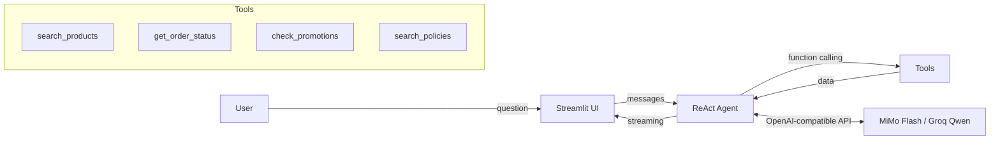

# 🎸 Empório da Música — Virtual Customer Service Agent

> Technical Challenge — AI Engineer | Artefact

[](https://python.org)
[](https://streamlit.io)

A conversational agent built with a **ReAct + Function Calling** architecture for customer support at a fictional musical instrument store based in Campo Grande/MS, Brazil.

The virtual assistant **Marina** queries the product catalog, order status, active promotions, and store policies in real time using tool calls — no hallucinations about data.

---

## 🏗️ Architecture



The agent follows the **Thought → Action → Observation → Answer** pattern:
1. Receives the user's question
2. Decides which tool to call (or responds directly)
3. Executes the tool and observes the result
4. Repeats if needed (up to 10 iterations)
5. Generates the final answer based on real data

---

## 📁 Project Structure

```
├── app.py                    # Streamlit interface (chat, sidebar, streaming)
├── agent.py                  # ReAct loop with streaming and multi-provider support
├── persona.py                # Marina's system prompt
├── core/
│   ├── loader.py             # Data loading (SQLite/CSV)
│   └── utils.py              # Shared utility functions
├── tools/
│   ├── product_search.py     # Product search (name, price, category, stock)
│   ├── order_lookup.py       # Order status and tracking
│   ├── promotion_check.py    # Active promotions with discounts
│   └── policy_search.py      # Store policies (section-based search on .md)
├── tests/
│   ├── conftest.py           # Shared fixtures (mock DataFrames)
│   ├── test_product_search.py
│   ├── test_order_lookup.py
│   ├── test_promotion_check.py
│   └── test_policy_search.py
├── scripts/
│   ├── build_kb.py           # Extracts PDF → politicas.md + compiles CSVs → SQLite
│   └── eval_agent.py         # Deterministic eval (15 scenarios, real data)
├── Data/                     # CSVs, SQLite, policy PDF
├── .github/workflows/ci.yml  # GitHub Actions (lint + test)
├── .streamlit/
│   ├── config.toml           # Visual theme
│   └── secrets.toml          # API keys (not versioned)
├── pyproject.toml            # Dependencies, pytest & ruff config
├── Makefile                  # DX shortcuts (run, test, lint, eval)
└── requirements.txt
```

---

## 🔧 Tools (Function Calling)

| Tool | Description | Parameters |
|---|---|---|
| `search_products` | Searches the 65-product catalog | `query`, `max_price`, `category`, `in_stock_only` |
| `get_order_status` | Retrieves order status and tracking | `order_id`, `customer_name` |
| `check_promotions` | Checks active promotions with discounts | `product_id`, `product_name` |
| `search_policies` | Queries store policies (returns, shipping, etc.) | `topic` |

---

## 🤖 Models & Providers

Selectable via sidebar — evaluators can compare behavior between providers:

| Model | Provider | SDK | Cost |
|---|---|---|---|
| MiMo V2.6 Flash | OpenRouter | `openai` (compatible) | Pay-per-use |
| Qwen 3.8 27B | Groq | `openai` (compatible) | Free |

The agent logic is **identical** for both — only the base URL, model name, and API key change. Adding a new provider is as simple as adding an entry to the `PROVIDERS` dict in `agent.py`.

---

## 🚀 Getting Started

### Prerequisites
- Python 3.10+
- API key from [Groq](https://console.groq.com) (free) or [OpenRouter](https://openrouter.ai/keys)

### Installation

```bash
# Clone the repository
git clone https://github.com/Chiposche/Emp-rio-da-M-sica.git
cd Emp-rio-da-M-sica

# Install dependencies
pip install -r requirements.txt

# Configure your API key
cp .env.example .env
# Edit .env with your key, OR:
mkdir -p .streamlit
echo 'GROQ_API_KEY = "gsk_your_key"' > .streamlit/secrets.toml

# (Optional) Rebuild the knowledge base
python scripts/build_kb.py

# Run
streamlit run app.py
```

---

## 🎯 Technical Decisions

### Why ReAct + Function Calling?
- **Explicit reasoning**: step-by-step thinking, easy to debug
- **Controlled scope**: well-defined tools prevent data hallucinations
- **Visible reasoning**: evaluators can see exactly what the agent queried (Debug Mode)

### Why no LangChain / LlamaIndex?
- Zero AI framework dependencies — the "AI" is just models called via REST API
- The code is pure, modular Python (~1,200 lines total)
- No AI requirements in the codebase, as per the challenge guidelines

### Why no RAG with Vector DB?
- Over-engineering for 65 products and 8 pages of PDF
- Keyword-based search on the `.md` file is sufficient and deterministic
- SQLite with indexes covers all necessary queries

### Why multi-provider?
- Demonstrates the architecture is model-agnostic
- Allows behavior comparison between providers
- Adding a new provider is a single dictionary entry

---

## 🎭 Persona — Marina

The virtual assistant has a defined personality in the system prompt:
- **Tone**: informal yet professional, empathetic, knowledgeable about music
- **Rules**: never fabricates prices/availability, always queries the tool first
- **Scope**: politely redirects out-of-scope questions
- **Escalation**: forwards complex complaints to the human team

---

## ⚡ UI Features

- **Token-by-token streaming** with TTFT (Time to First Token) measurement
- **Debug Mode** — displays ReAct reasoning (tools called, arguments, return values)
- **Quick suggestions** — 4 clickable buttons for common test scenarios
- **Latency metrics** — total time, TTFT, model used, tool rounds
- **Custom visual theme** (store colors: brown/copper)
- **Conversation history** managed per session

---

## ✅ Quality & CI

- **25 pytest tests** covering all 4 tools with mock fixtures (`make test`)
- **15-scenario eval script** against real data (`make eval`)
- **Ruff linting** configured with per-file rules (`make lint`)
- **GitHub Actions CI** — lint + tests on Python 3.10 and 3.12 for every push/PR
- **Prompt injection guardrails** — Marina refuses system prompt leaks and role hijacking
- **Makefile** — `make run`, `make test`, `make lint`, `make eval`, `make install`

---

## ⚠️ Known Limitations

- Static data (pre-loaded CSVs, no real-time system integration)
- No conversation persistence across sessions (`st.session_state` only)
- Policy search is keyword-based (no semantic embeddings)

---

## 🔮 What I'd Do with More Time

- **Semantic search (RAG)**: embed products and policies with a lightweight model, use cosine similarity for retrieval — overkill now, but necessary at scale
- **Conversation persistence**: store sessions in a database so users can resume conversations
- **PII masking**: detect and redact personal data before sending to the LLM
- **Observability**: structured logging with OpenTelemetry traces per agent turn
- **Multi-language support**: detect user language and switch Marina's persona accordingly
- **Admin dashboard**: Streamlit page showing tool usage stats, most-queried products, and error rates

---

## 🛠️ Built with AI Assistance

This project was developed with **Claude Code** (Anthropic's CLI agent) as a pair-programming partner. Here's how the workflow looked in practice:

1. **Architecture design** — I described the challenge requirements and constraints; Claude Code proposed the ReAct + Function Calling pattern and the modular `tools/` structure. I chose which suggestions to keep and which to discard.
2. **Iterative implementation** — Each module was built incrementally: I wrote the initial logic, Claude Code reviewed it, suggested improvements (e.g., `lru_cache` on the HTTP client, `search_text` pre-computation in the loader), and I decided what to merge.
3. **Refactoring** — After the single-provider version worked, I asked Claude Code to help refactor into multi-provider support. It generated the `PROVIDERS` dict pattern; I validated and tuned model choices.
4. **Debugging** — When Groq models looped or returned 404s, Claude Code helped diagnose the issue (model availability changes) and suggested alternatives.
5. **Documentation** — This README was structured collaboratively: I defined what sections to include, Claude Code drafted the content, I reviewed and edited.

**All architectural decisions, business logic, and technical trade-offs were made by me.** Claude Code accelerated implementation but did not make design choices autonomously.

---

## 📄 Dependencies

```
streamlit>=1.30.0          # Chat interface + deployment
openai>=1.10.0             # HTTP client (OpenAI-compatible API)
google-genai>=2.0.0        # Legacy (kept for compatibility)
pandas>=2.0.0              # CSV data manipulation
pdfplumber>=0.9.0          # PDF text extraction
python-dotenv>=1.0.0       # Environment variables (.env)
```

> Zero dependencies on LangChain, LlamaIndex, Haystack or similar frameworks.

---

*Gustavo Chiposche Pedro — AI Engineer Technical Challenge | Artefact*
