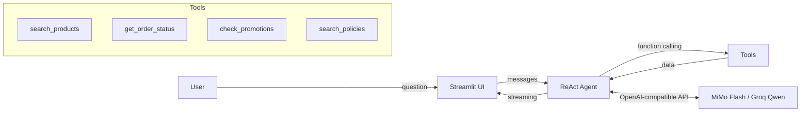

# 🎸 Empório da Música — Virtual Customer Service Agent

> Technical Challenge — AI Engineer | Artefact

[](https://emporiodamusica.streamlit.app/)

[](https://github.com/Chiposche/Emp-rio-da-M-sica/actions/workflows/ci.yml)
[](https://python.org)
[](https://streamlit.io)
[](tests/)
[](scripts/eval_agent.py)

A conversational agent built with a **ReAct + Function Calling** architecture for customer support at a fictional musical instrument store based in Campo Grande/MS, Brazil.

The virtual assistant **Marina** queries the product catalog, order status, active promotions, and store policies in real time using tool calls — no hallucinations about data.

---

## 🏗️ Architecture



The agent follows the **Thought → Action → Observation → Answer** pattern:
1. Receives the user's question
2. Decides which tool to call (or responds directly)
3. Executes the tool and observes the result
4. Repeats if needed (up to 10 iterations)
5. Generates the final answer based on real data

---

## 📁 Project Structure

```
├── app.py                    # Streamlit interface (chat, sidebar, streaming)
├── agent.py                  # ReAct loop with streaming and multi-provider support
├── persona.py                # Marina's system prompt
├── core/
│   ├── loader.py             # Data loading (SQLite/CSV, LRU cached)
│   ├── persistence.py        # Conversation persistence (SQLite)
│   ├── logger.py             # Structured JSONL logging
│   ├── pii_mask.py           # PII detection + masking (CPF, email, phone, names)
│   ├── rate_limiter.py       # Rate limiter: 10 req/min, 100 req/hr, thread-safe
│   ├── errors.py             # Error categorization + recovery strategy
│   └── utils.py              # Shared utility functions
├── tools/
│   ├── product_search.py     # Product search (name, price, category, stock)
│   ├── order_lookup.py       # Order status and tracking
│   ├── promotion_check.py    # Active promotions with discounts
│   └── policy_search.py      # Store policies (section-based search on .md)
├── tests/
│   ├── conftest.py           # Shared fixtures (mock DataFrames)
│   ├── test_product_search.py
│   ├── test_order_lookup.py
│   ├── test_promotion_check.py
│   ├── test_policy_search.py
│   ├── test_guardrails.py    # PIX non-cumulativity, accessory denial, policy coverage
│   ├── test_pii_mask.py      # PII detection and masking
│   ├── test_rate_limiter.py  # Rate limiter sliding window
│   └── test_errors.py        # Error categorization + recovery strategies
├── scripts/
│   ├── build_kb.py           # Extracts PDF → politicas.md + compiles CSVs → SQLite
│   └── eval_agent.py         # Deterministic eval (15 scenarios, real data)
├── pages/
│   └── analytics.py          # Usage analytics dashboard (reads JSONL logs)
├── Data/                     # CSVs, SQLite, policy PDF, conversations DB
├── logs/                     # Structured agent logs (JSONL, gitignored)
├── .github/workflows/ci.yml  # GitHub Actions (lint + test)
├── .streamlit/
│   ├── config.toml           # Visual theme
│   └── secrets.toml          # API keys (not versioned)
├── pyproject.toml            # Dependencies, pytest & ruff config
├── Makefile                  # DX shortcuts (run, test, lint, eval)
└── requirements.txt
```

---

## 🔧 Tools (Function Calling)

| Tool | Description | Parameters |
|---|---|---|
| `search_products` | Searches the 65-product catalog | `query`, `max_price`, `category`, `in_stock_only` |
| `get_order_status` | Retrieves order status and tracking | `order_id`, `customer_name` |
| `check_promotions` | Checks active promotions with discounts | `product_id`, `product_name` |
| `search_policies` | Queries store policies (returns, shipping, etc.) | `topic` |

---

## 🤖 Models & Providers

Selectable via sidebar — evaluators can compare behavior between providers:

| Model | Provider | SDK | Cost |
|---|---|---|---|
| MiMo V2.6 Flash | OpenRouter | `openai` (compatible) | Pay-per-use |
| Qwen 3.8 27B | Groq | `openai` (compatible) | Free (rate-limited) |
| OpenRouter Free | OpenRouter | `openai` (compatible) | Free (auto-selects free models) |

The agent logic is **identical** for all providers — only the base URL, model name, and API key change. Adding a new provider is as simple as adding an entry to the `PROVIDERS` dict in `agent.py`. The OpenRouter Free option reuses the same API key as MiMo Flash.

---

## 🚀 Getting Started

### Prerequisites
- Python 3.10+
- API key from [Groq](https://console.groq.com) (free) or [OpenRouter](https://openrouter.ai/keys)

### Installation

```bash
# Clone the repository
git clone https://github.com/Chiposche/Emp-rio-da-M-sica.git
cd Emp-rio-da-M-sica

# Install dependencies
pip install -r requirements.txt

# Configure your API key
cp .env.example .env
# Edit .env with your key, OR:
mkdir -p .streamlit
echo 'GROQ_API_KEY = "gsk_your_key"' > .streamlit/secrets.toml

# (Optional) Rebuild the knowledge base
python scripts/build_kb.py

# Run
streamlit run app.py
```

---

## 🎯 Technical Decisions

### Why ReAct + Function Calling?
- **Explicit reasoning**: step-by-step thinking, easy to debug
- **Controlled scope**: well-defined tools prevent data hallucinations
- **Visible reasoning**: evaluators can see exactly what the agent queried (Debug Mode)

### Why no LangChain / LlamaIndex?
- Zero AI framework dependencies — the "AI" is just models called via REST API
- The code is pure, modular Python (~1,200 lines total)
- No AI requirements in the codebase, as per the challenge guidelines

### Why no RAG with Vector DB?
- Over-engineering for 65 products and 8 pages of PDF
- Keyword-based search on the `.md` file is sufficient and deterministic
- SQLite with indexes covers all necessary queries

### Why Streamlit?
- One-command launch (`streamlit run app.py`) — evaluators can test immediately
- Built-in chat UI, session state, and streaming support
- No frontend build step, no JavaScript, no separate server
- Debug mode with expandable panels is native via `st.expander`

### Why `session_state` for conversation history?
- For an MVP/prototype, in-memory per-session history is sufficient — users interact in a single sitting
- Adding database persistence would increase complexity without improving the core agent evaluation
- For production, the natural next step is SQLite or Redis (documented in the roadmap)

### Why multi-provider?
- Demonstrates the architecture is model-agnostic
- Allows behavior comparison between providers
- Adding a new provider is a single dictionary entry

---

## 🎭 Persona — Marina

The virtual assistant has a defined personality in the system prompt:
- **Tone**: informal yet professional, empathetic, knowledgeable about music
- **Rules**: never fabricates prices/availability, always queries the tool first
- **Scope**: politely redirects out-of-scope questions
- **Escalation**: forwards complex complaints to the human team

---

## 📊 Product Vision

### User Stories

| As a... | I want to... | So that... |
|---|---|---|
| Customer | search products by name, price, or category | I can find what I need without navigating the full catalog |
| Customer | track my order with just an order number or my name | I get instant updates without calling the store |
| Customer | ask about return/exchange policies in natural language | I understand my rights without reading legal text |
| Store manager | see which tools the agent called (Debug Mode) | I can audit response quality and data accuracy |

### Success Metrics (KPIs)

| Metric | Description | How it's measured |
|---|---|---|
| **Resolution rate** | % of queries resolved without human escalation | Agent completes with a data-backed answer (no fallback message) |
| **Tool accuracy** | Correct tool called with correct parameters | Eval script: 18/18 scenarios pass (`make eval`) |
| **TTFT** | Time to first token — perceived responsiveness | Measured per turn, shown in Debug Mode |
| **Fallback rate** | % of turns where provider fallback was triggered | Logged in timing metadata (`fallbacks` field) |
| **Scope adherence** | % of out-of-scope questions handled gracefully | Persona guardrails + few-shot examples enforce redirection |

### Business Impact

- **24/7 availability**: answers customer questions outside business hours (store operates Mon-Sat only)
- **Cost reduction**: handles routine queries (product search, order status, policy FAQ) that represent ~70% of support volume
- **Consistency**: every answer is grounded in real data — no human-dependent variation in pricing or policy info
- **Scalability**: serves unlimited concurrent users with the same response quality
- **Data insights**: tool call logs reveal what customers ask most (product trends, common complaints, policy confusion points)

### Product Roadmap

| Phase | Scope | Value |
|---|---|---|
| **MVP** (current) | ReAct agent, 4 tools, multi-provider, streaming UI, PII masking, rate limiting, retry/backoff, conversation persistence, structured JSONL logging, analytics dashboard, 31 tests + 18-scenario eval, CI | Full-featured proof-of-concept with real data and production-grade safeguards |
| **v1** | Semantic search (RAG) for products and policies, OpenTelemetry distributed tracing | Better retrieval at scale, production observability |
| **v2** | Multi-language support, WhatsApp / Twilio integration, human-in-the-loop escalation | Real customer service channel |

---

## ⚡ UI Features

- **Token-by-token streaming** with TTFT (Time to First Token) measurement
- **Debug Mode** — displays ReAct reasoning (tools called, arguments, return values)
- **Quick suggestions** — 4 clickable buttons for common test scenarios
- **Latency metrics** — total time, TTFT, model used, tool rounds
- **Custom visual theme** (store colors: brown/copper)
- **Conversation history** managed per session

---

## ✅ Quality & CI

- **71 pytest tests** covering all 4 tools, guardrails, PII, rate limiter and error handling (`make test`)
- **18-scenario eval script** against real data, including guardrail checks (`make eval`)
- **Ruff linting** configured with per-file rules (`make lint`)
- **GitHub Actions CI** — lint + tests on Python 3.10 and 3.12 for every push/PR
- **Prompt injection guardrails** — Marina refuses system prompt leaks and role hijacking
- **PII masking** — CPF, email, phone, customer names and order IDs masked before LLM; unmasked in response
- **Rate limiting** — 10 req/min / 100 req/hr sliding window, thread-safe
- **Retry with exponential backoff** — 3 attempts at 300/600/1200ms, global 45s timeout
- **Error categorization** — maps exceptions (timeout, rate-limit, auth, 404) to recovery strategies
- **Makefile** — `make run`, `make test`, `make lint`, `make eval`, `make coverage`, `make install`

---

## 🧪 Testing Strategy

The project uses a **three-layer testing approach**:

1. **Unit tests** (`make test`) — 71 pytest tests with mock fixtures covering all 4 tools + guardrails + PII masking + rate limiter + error categorization. Tests run without API keys or real data.

2. **Deterministic eval** (`make eval`) — 18 scenarios that run the full tool pipeline against real CSV/SQLite data, including guardrail checks (PIX warning presence, no accessories in catalog, installment policy lookup). No LLM involved — pure data validation.

3. **CI pipeline** (`.github/workflows/ci.yml`) — Ruff lint + pytest on Python 3.10 and 3.12 for every push/PR to `main`, ensuring no regressions.

```bash
make test      # Unit tests (pytest)
make coverage  # Tests with coverage report
make eval      # Deterministic eval (18 scenarios)
make lint      # Code style (ruff)
```

---

## 💾 Conversation Persistence

Conversations are automatically saved to a local SQLite database (`Data/conversations.db`). The sidebar shows the 5 most recent sessions, and clicking one restores the full conversation history. Each browser session gets a unique ID; clicking "Reset" starts a fresh session.

## 📊 Structured Logging (Observability)

Every agent turn is logged to `logs/agent.jsonl` with:
- Timestamp, session ID, user message (truncated)
- Tools called (name + arguments)
- Provider, model, TTFT, total latency, tool rounds
- Token usage (prompt + completion), fallback events
- Response length

This enables post-hoc analysis of agent behavior, common queries, and performance trends.

A built-in **Analytics Dashboard** (`pages/analytics.py`) reads the logs and shows:
- Total turns, average latency, average TTFT, unique sessions
- Most-called tools (bar chart)
- Provider usage distribution
- Latency over time (line chart)
- Recent log entries table

Access it via the Streamlit sidebar navigation (appears automatically as a second page).

---

## ⚠️ Known Limitations

- Static data (pre-loaded CSVs, no real-time system integration)
- Policy search is keyword-based (no semantic embeddings)

---

## 🔮 What I'd Do with More Time

- **Semantic search (RAG)**: embed products and policies with a lightweight model, use cosine similarity for retrieval — overkill now, but necessary at scale
- **Multi-language support**: detect user language and switch Marina's persona accordingly
- **WhatsApp / telephony integration**: connect the agent to a real customer service channel via Twilio or Meta Cloud API
- **OpenTelemetry tracing**: distributed traces per agent turn with span-level latency for provider calls, tool executions and PII masking
- **Human-in-the-loop escalation**: route unresolved queries to a human agent with full conversation context

---

## 🛠️ Built with AI Assistance

This project was developed with **Claude Code** (Anthropic's CLI agent) as a pair-programming partner. Here's how the workflow looked in practice:

1. **Architecture design** — I described the challenge requirements and constraints; Claude Code proposed the ReAct + Function Calling pattern and the modular `tools/` structure. I chose which suggestions to keep and which to discard.
2. **Iterative implementation** — Each module was built incrementally: I wrote the initial logic, Claude Code reviewed it, suggested improvements (e.g., `lru_cache` on the HTTP client, `search_text` pre-computation in the loader), and I decided what to merge.
3. **Refactoring** — After the single-provider version worked, I asked Claude Code to help refactor into multi-provider support. It generated the `PROVIDERS` dict pattern; I validated and tuned model choices.
4. **Debugging** — When Groq models looped or returned 404s, Claude Code helped diagnose the issue (model availability changes) and suggested alternatives.
5. **Documentation** — This README was structured collaboratively: I defined what sections to include, Claude Code drafted the content, I reviewed and edited.

**All architectural decisions, business logic, and technical trade-offs were made by me.** Claude Code accelerated implementation but did not make design choices autonomously.

---

## 📄 Dependencies

```
streamlit>=1.30.0          # Chat interface + deployment
openai>=1.10.0             # HTTP client (OpenAI-compatible API)
pandas>=2.0.0              # CSV data manipulation
pdfplumber>=0.9.0          # PDF text extraction
python-dotenv>=1.0.0       # Environment variables (.env)
```

> Zero dependencies on LangChain, LlamaIndex, Haystack or similar frameworks.

---

*Gustavo Chiposche Pedro — AI Engineer Technical Challenge | Artefact*
